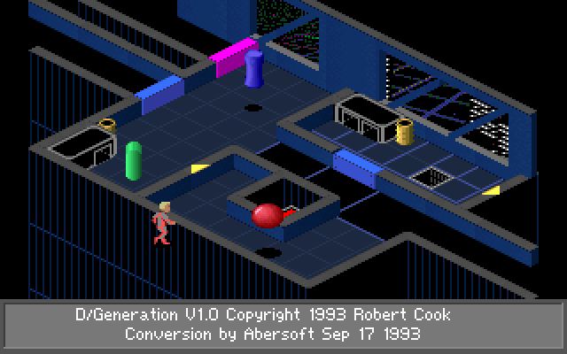
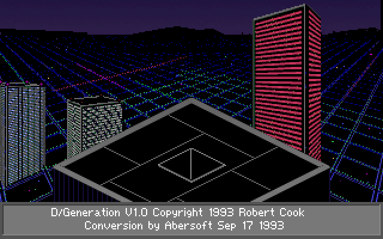
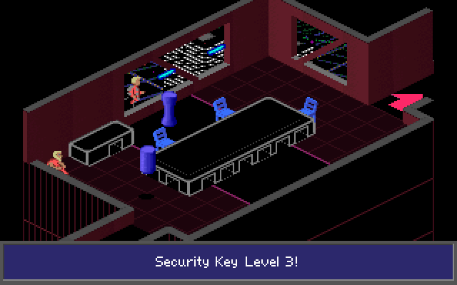
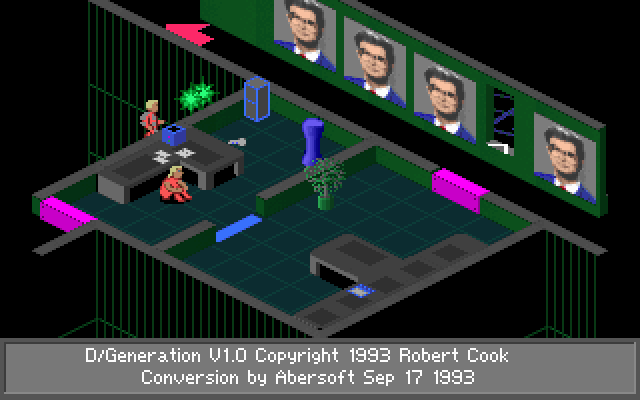

# D/Generation - TypeScript port of the Amiga AGA release

**[Play it in your browser](https://dux.github.io/d-generation/)** - the GitHub Pages build of `./docs`, no install, keyboard or gamepad.

Made for fast nostalgia re-run, with added unlimited lives, save/restore and an Enhanced 2x view. Amiga lives forever!

| | |
|---|---|
|  |  |
|  |  |

Screenshots are rendered by the TypeScript port itself (`bun tools/lockstep/render.ts --scene <n>`), shown at 2x.

This is a 1:1 accurate port of **D/Generation V1.0 for the Amiga AGA** (Robert Cook, conversion by Abersoft, 17 Sep 1993), the full, final release of the game, to plain TypeScript running in the browser.
It is not an emulator.
The original 68000 executable was disassembled routine by routine and rewritten as typed TypeScript state and functions, and every ported routine was checked against the original executable running in a 68000 emulator.
Same rooms, same objects, same AI, same random number sequence, same integer quirks, same game state frame by frame for the same input.

## Status: finished and tested

The port is complete: the whole game runs from the intro and title through all ten floors, the finale with the creature and the dish, and every ending.
It has been played through to the finale in the browser, and every part is checked against the original executable:

* all 139 lockstep scenarios run with no divergence in game state;
* the frame verifier shows the creature's death in scene 122 (the gore splat, the smashed dish, the palette after the red flash) pixel- and colour-identical to the original for every frame of the kill;
* rooms, conversations, inventory, terminals, intro cards, HUD, pause, endings and save states pass their own frame verifiers.

## Why "1:1"

The port is verified in lockstep against the original, not eyeballed.

* A harness (`./tools/m68k/amigaemu.py`, unicorn + stubbed AmigaOS libraries + emulated blitter) runs the original `dgen` executable from the AGA disks.
* `bun run lockstep` steps the original and the TypeScript game with the same input and reports the first frame, global variable or object field that differs.
* The attract demo (3000 main-loop passes, both demos and three attract handoffs) runs with no divergence, both from a native boot and from a state imported from the original.
* 139 scenarios (`./tools/scenarios/`) cover new game, every object class, room exits (including the way out of Derrida's room), lifts, deaths, pickups, conversations, inventory, every terminal, saves, the bomber and the endings, all with no divergence.
* Room drawing is compared pixel by pixel with the original's drawing: 115 of 121 rooms are identical, the other 6 differ only where the original reads past the end of the 100-row city backdrop.
* Conversations, inventory, terminals, intro cards, HUD, pause, endings and save states have their own frame verifiers (`./tools/verify-*.ts`).
* Every ported function starts with a comment naming its address in the original executable, e.g. `// h0:4cbc plyUpdate(): ...`, so any line can be traced back to the 68000 code.
* Integer semantics are kept where they are observable: 8.8 fixed-point positions, byte timers, signedness, wrap-around, truncating division and the order of random calls.

One deliberate difference in drawing: the native renderer draws whole frames, so it does not reproduce the original's dirty-rectangle glitches (objects that moved half a pixel not being redrawn, equal-depth sprites sorting differently in partial redraws).

Full details: `./doc/porting.md` (architecture, rules, verification status, known limits) and `./doc/formats.md` (every original file format).

## Added in this port

Eight additions to the original game, added by Dino Reic ([@dux](https://github.com/dux)).
All live in the browser host (`./src/game/host/worker.ts`); the ported game code only gained two hooks for it (`Game.onLevelRestart`, called after the original Ctrl+R restart, and `Game.spawnCreature`, the original creature spawn), and plays exactly as the executable without the host.

* **Save / restore anywhere:** F5 / F9, or the Save / Restore buttons in the header, save and restore the full game state at any moment (kept in IndexedDB).
  The original checkpoint saves (Alt+S / Alt+R) still work as before.
* **Unlimited lives:** after every main-loop pass the host sets the lives counter back to 5, so you never get a game over.
* **Restart level button:** asks first, then restarts from the floor checkpoint like the original game's Ctrl+R (the same restart as losing your last life): back to where you arrived on the current floor, with every room of the floor reloaded.
  The key itself is mostly out of reach in a browser, which reloads the page on Ctrl+R.
  During the finale it also gives the escape countdown back (see "15 minutes to escape").
* **Enhanced view:** the Enhanced button doubles the picture to 640x400 with Hyllian's xBR-lv2-noblend on the GPU (WebGL2) before it is scaled to the window.
  It follows 1:1 and 2:1 edges, so diagonal lines get even steps at the doubled resolution, and every new pixel takes one of its neighbours' colours: no blur, no new colours.
  Off by default; the setting is remembered.
* **Survivors' gifts up front:** four survivors hand over an item only for one particular answer: the bomb in scene 23, Michelle's bomb in scene 28, the shield in scene 35 and River's shield in scene 75.
  Here each gift is yours as soon as you start talking to them, once.
* **+Grenade / +Bomb buttons:** one more grenade (up to 99) or bomb (up to 9) per click.
* **15 minutes to escape:** after the dream (the eyes and cross) and Derrida's room, the original gives you a hidden countdown of about 100 seconds to reach the exit control room, scene 121, before it cuts to the jet-pack; here it is about 15 minutes.
  Restart level while it runs, or any time after it stopped until you fry the creature (the creature out in scene 121, a death's jet-pack cut, the ending text), gives you the whole 15 minutes again from where you arrived on the floor.
* **The creature waits in scene 121:** the original shows it only on the entry that stops the countdown; here it is back every time you enter the room until the dish fries it.

## How each part was ported

| Part | Original | Ported as | Where | Checked by |
|---|---|---|---|---|
| Game logic (main loop, objects, AI, collisions, timers) | SAS/C 68000 code in `dgen` (hunk h0) | Disassembled routine by routine and rewritten as typed TypeScript state and functions, each tagged with its `h0:` address; one module per object class | `./src/game/core/`, `./src/game/actors/` | `bun run lockstep`, 139 scenarios |
| Random numbers | `h0:e7f4`, two byte LCGs in one word | Same generator, including the original's high-byte read quirk and the order of calls | `./src/game/core/random.ts` | lockstep (seed is compared) |
| Levels | `DATA/L1..L10.SCN`, `MAPMTX0..2.DAT` room packs | Decoded to one editable JSON5 file per floor; rooms build their own runtime grid, level data stays read-only | `./levels/`, `./src/formats/level.ts` | `bun run extract:levels` round trip, byte for byte |
| Sprites | `aga/*.aga` shape trees of bitplane frames with a mask plane | Atlas PNG per bank (grey = palette index, alpha = mask) plus JSON sets and frame offsets; the blitter draw and horizontal mirror (`h10:16`, `h10:262`) are reimplemented on indexed pixels | `./assets/sprites/`, `./src/formats/shape.ts`, `./src/game/render/gfx.ts` | extractor reads every file back and compares it with the original decode |
| Room decoration (delta images) | `DATA/DLTSET*.DAT` run-length command streams | Commands pre-rendered to grey + alpha atlases with draw offsets; colour `0xfc` still shows the backdrop | `./assets/deltas/`, `./src/formats/delta.ts` | `bun run verify:aga-rooms` |
| Room drawing | `h0:1250` | Same order: tiles, floor lines, back deltas, walls with joins, tall wall tops, drops and lines, front deltas; clipped at row 181 | `./src/game/render/room.ts` | 115 of 121 rooms pixel-identical |
| Object drawing | Dirty-rectangle redraw with depth sorting and wall occlusion | Same ordering and occlusion, but whole frames are drawn every time | `./src/game/render/objects.ts` | `bun run verify:aga-frames` |
| Pictures and backdrop | LZW `*.vim` (8 bitplanes), `BACK1.DAT`, CD32 keyboard and pad menu in hunk 9 | Unpacked to grey PNGs of palette indexes, decoded in the browser so indexes stay indexes | `./assets/images/`, `./src/formats/png.ts` | extractor read-back |
| Palettes and effects | `DATA/*.PAL` (6-bit), palette scripts `h0:b0dc` | `palettes.json`; room schemes swap colours 32..79, flashes and scripts are ported code | `./assets/palettes.json`, `./src/game/core/effects.ts` | lockstep, frame verifiers |
| Font and text | Glyphs in shape set 36 of `b1.aga`, advance table `g:3b03`, strings in the data hunk | Glyphs come from the sprite atlas, word wrap and `\|c` colour codes are ported, strings are TypeScript constants | `./src/game/render/gfx.ts`, `./src/game/ui/talk/text.ts` | `./tools/verify-talk-frames.ts`, `./tools/verify-ui-frames.ts` |
| Sound effects | `amiga.eff` (raw signed 8-bit), sample table `h11:45e6`, sound table `h11:44f6`, Paula driver `h0:1551a` / `h10:37f6` | One WAV per sample; a WebAudio driver keeps Paula's four channels, first-free-channel allocation, stereo sides and the `3546895 / period` rate; sounds 33 and 48 loop | `./assets/sounds/`, `./src/formats/sound.ts`, `./src/game/host/audio.ts` | extractor read-back |
| Music | OctaMED `dgen.mod` and `dgen2.mod`, started by `h0:77ec`, stopped when `amiga.eff` is loaded | Rendered once with libopenmpt (chiptune3) to Opus and looped; the game emits `music` events from the same phases: `dgen` on the first title pass (ends after the module's tick length), none in demos and play, `dgen2` in the good ending | `./assets/music/`, `./src/audio/music.ts`, `./src/game/core/game.ts` | title timing via lockstep |
| Attract demos | `DATA/DEMO50.SEQ`, `DEMO52.SEQ` | JSON direction and button records, replayed by the ported demo player | `./assets/demos/`, `./src/game/core/demo.ts` | 3000-pass attract run, no divergence |
| UI (title, intro, HUD, pause, conversations, inventory, terminals, endings, CD32 menu) | Game code in h0 | Ported like the game logic | `./src/game/ui/` | `./tools/verify-ui-*.ts`, `./tools/verify-talk-frames.ts` |
| Input | Amiga raw key codes, CD32 pad, on-screen keyboard for prompts | Browser keys sent as raw codes, gamepad mapped to the pad; the host drives the on-screen keyboard when you type | `./src/game/core/input.ts`, `./src/game/host/input.ts`, `./src/game/host/typing.ts` | scenarios replay raw key and joystick events |
| Timing | PAL vblank and CIA interrupts, synchronous busy waits | Game runs in a Worker on shared memory, one call per 20 ms tick, sleeping on Atomics so the original waits run unchanged | `./src/game/host/worker.ts` | lockstep under the harness tick model |
| Saves | Checkpoint save of nonvolatile items, `DATA/DGEN.CFG` | Checkpoints in localStorage, `config.json`; save states (F5 / F9) added on top in IndexedDB | `./src/game/ui/save.ts`, `./src/game/host/host.ts` | `./tools/verify-snapshot.ts` |

## The game

You are a jet-pack courier delivering a package to Genoq Biolabs in Singapore, 2021.
You land on the 80th floor and the building seals itself behind you: the security system has gone haywire and Genoq's bioweapons (A/Generation, B/Generation and C/Generation) are loose.
Fight your way up ten floors of isometric rooms, solve door, switch, laser and teleporter puzzles, rescue the trapped staff and find Dr. Derrida, the head of the special operations lab.

D/Generation was first published by Mindscape in 1991 for MS-DOS, then for Amiga OCS/ECS and Atari ST (1992), Amiga AGA and CD32 (1993).
The AGA executable is the CD32 code base: 256-colour graphics, the CD32 pad menu and the on-screen keyboard for terminal prompts.

## Play

```sh
bun install
bun dev          # development page: Play, plus room / sprite / delta viewers
bun run build    # GitHub Pages site into ./docs (game.html as index.html)
bun run preview  # serve ./docs locally with the COOP/COEP headers
```

The game runs in a module Worker on shared memory, so it needs cross-origin isolation; `bun dev` sends the headers and the Pages build adds them with a service worker (`./src/pages/coi-sw.js`).

### Controls

* Arrow keys or keypad move; held arrows combine into diagonals.
* All other keys are passed through as Amiga raw key codes, so the original keyboard controls work as in the manual.
* Gamepad: stick or d-pad moves, button 0 fires, button 1 uses.
* Terminal prompts: just type; the host drives the CD32 on-screen keyboard for you (Enter = RET, Backspace = DEL).
* Space (or gamepad button 1): the laser, which bounces off walls and triggers switches.
* T (or gamepad button 0): throw a grenade the way you face; you need grenades picked up on the way (S shows how many).
* Enter: talk to the survivor in front of you; up / down picks an answer, Enter takes it, and the conversation goes on until you leave it with Esc (or gamepad button 0).
* U: the inventory; left / right picks an item, Enter (or gamepad button 1) uses it, Esc or U closes it.
  Only items you have are shown: bomb, freezer, shield, barrier and the package; a placed bomb blasts doors.
* Alt+S / Alt+R: the original checkpoint save and restore (kept in localStorage).
* F5 / F9, or the Save / Restore buttons: save states (kept in IndexedDB).
* Restart level button (the original Ctrl+R): back to where you arrived on the current floor, after a confirmation.
* +Grenade / +Bomb buttons: one more grenade or bomb.
* Enhanced button: twice the pixel density (xBR-lv2-noblend) on or off.
* Ctrl+B: the original CD32 menu.

### Passwords

The terminal in scene 23 (building floor 81) asks for a user name and passcode; Seth, the survivor in scene 4, gives them away:

* Username: `Seth`
* Password: `Ostrich`

The entrance-code terminal in scene 82 (building floor 84) has no fixed password.
Its code is one of the four horsemen, `War`, `Death`, `Pestilence` or `Famine`, picked when the title screen last ran, and John of Maryland in scene 84 tells you which one ("I am the bringer of ...").
In this port a game started right after loading the page uses `Death`; a game started after going back to the title screen uses `War`.

The exit control terminal in scene 121 (building floor 89) needs no typing; it only shows "Passcode 'REGENERATION' has been entered.  Exit door is now open."

### Hints

The guaranteed bombs come from survivors: the one in scene 23 (building floor 81) and Michelle in scene 28 (building floor 82).
Shields come from the survivor in scene 35 (building floor 82) and River in scene 75 (building floor 85, "some sort of personal barrier").
Each of them stays seated until their room is secured and they can see you; then Enter starts the conversation and the gift is yours (see "Added in this port").
In the original you only get it for one answer (for River `No.`, then `No, you aren't fat.`, then `OK!  OK!  You're fat and ugly!`); that answer still adds one more.
One more bomb is in the plain cubicle of scene 39: cubicle items are rolled from a fixed seed here, so it is always a bomb.
Restart level reloads the floor and with it the survivors.

## Repository layout

* `./src/game/core/`: game state, boot and main loop, input, floors and rooms, object system, collisions, timers, random, messages, palette effects.
* `./src/game/actors/`: one module per original object class (player, doors, lasers, lifts, teleporters, survivors, bioweapons, Derrida, ...).
* `./src/game/render/`: room and object drawing with the original's ordering and wall occlusion.
* `./src/game/ui/`: title, intro, attract, pause, saves, endings, conversations, inventory, terminals, CD32 menus.
* `./src/game/host/`: browser host (Worker, keyboard and gamepad, WebAudio, saves).
* `./levels/floor01.json5` .. `floor10.json5`: the ten floors as editable JSON5, round-trip checked byte for byte against the original `L1..L10.SCN` packs (schema in `./levels/README.md`).
* `./assets/`: graphics, palettes, sounds and music converted from the original files by `bun run extract:assets`.
* `./amiga/adf/`, `./amiga/aga/`: the two original AGA disk images and their unpacked files, the source of truth; git-ignored, not in this repository (bring your own, see below).
* `./tools/`: 68000 harness, disassembly kit, lockstep runner, scenario runner and frame verifiers.

## Get the original game

The original Amiga release can be found on these archive and abandonware sites:

* [Lemon Amiga - D/Generation AGA](https://www.lemonamiga.com/game/d-generation-aga) (the release this port is based on)
* [Lemon Amiga - D/Generation OCS/ECS](https://www.lemonamiga.com/game/d-generation)
* [Lemon Amiga - D/Generation CD32](https://www.lemonamiga.com/game/d-generation-cd32)
* [Lemon Amiga - original manual](https://www.lemonamiga.com/doc/d-generation/472)
* [Hall of Light - the Amiga games database](https://hol.abime.net/256) (more entries: [3557](https://hol.abime.net/3557), [257](https://hol.abime.net/257))
* [Free Game Downloads (mosw) - D/Generation AGA](https://free-game-downloads.mosw.com/abandonware/amiga/games_d_e/d_generation_aga.html)
* [GamesNostalgia - D/Generation](https://gamesnostalgia.net/game/dgeneration)
* [OpenRetro - D/Generation (Amiga)](https://openretro.org/amiga/d-generation)
* [WHDLoad install by JOTD](https://whdload.de/games/DGeneration.html) (hard-disk installer for the ECS/AGA/CD32 versions)
* [My Abandonware - D/Generation (DOS)](https://www.myabandonware.com/game/d-generation-14l)
* [Abandonware France - D/Generation (DOS, credits)](https://www.abandonware-france.org/ltf_abandon/ltf_jeu.php?id=321)
* [Internet Archive - D/Generation (DOS, playable in the browser)](https://archive.org/details/msdos_D-Generation_1991)

Background and reviews: [Wikipedia](https://en.wikipedia.org/wiki/D/Generation), [MobyGames](https://www.mobygames.com/game/1274/dgeneration/), [Amiga Power 32 review of the CD32 version (Amiga Magazine Rack)](https://amr.abime.net/review_1427).

## Credits and attribution

D/Generation is the work of its original authors; this repository only translates their program to another language.

Game credits, as shown on the game's own credits screen (`DATA/CRED.VIM`):

| Role | Name |
|---|---|
| Programming | Robert Cook (now Veda Hlubinka-Cook) |
| Programming | Jim Brown |
| Programming | John Jones-Steele |
| Title music | Sean Gugler |
| Additional graphics | Vicki Sidley, Tansi Brooks, Steve Leney |

* Original design: Robert Cook, who first built the game as *D-Generation* for the 128K Apple IIe in 1989-1990 (never released).
* Amiga conversion: Abersoft ("Conversion by Abersoft Sep 17 1993" in the executable).
* Publisher: Mindscape, Inc. (US) and Mindscape International (Europe).
* Copyright line in the executable: "Copyright 1993 Robert Cook and Mindscape".

Tools and libraries used by the port:

* [amitools](https://github.com/cnvogelg/amitools) (`xdftool`) to unpack the ADF disk images.
* [Unicorn](https://www.unicorn-engine.org/) and [Capstone](https://www.capstone-engine.org/) for the 68000 harness and disassembly.
* [chiptune3](https://github.com/DrSnuggles/chiptune) / libopenmpt to render the original `dgen.mod` and `dgen2.mod` tracks.
* [xBR-lv2-noblend](https://github.com/libretro/glsl-shaders/blob/master/xbr/shaders/xbr-lv2-noblend.glsl) by Hyllian (MIT) for the Enhanced view, ported to WebGL2 in `./src/game/host/xbr.ts`.
* [Vite](https://vite.dev/), [Bun](https://bun.sh/), [TypeScript](https://www.typescriptlang.org/), [json5](https://json5.org/).

## Rights

D/Generation, its code, graphics, levels, text, sound and music are copyright Robert Cook and Mindscape and their successors in interest.
This is a non-commercial preservation and study project with no affiliation to the rights holders.
If you own rights to the game and want something changed or removed, please open an issue.
